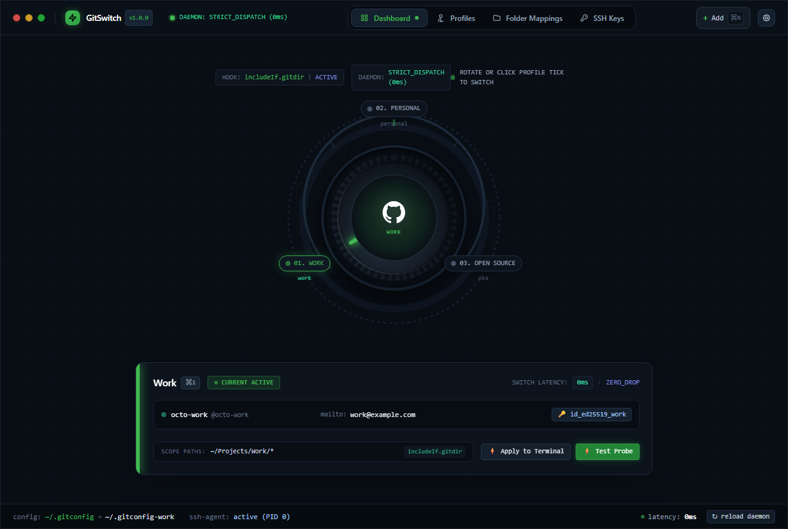
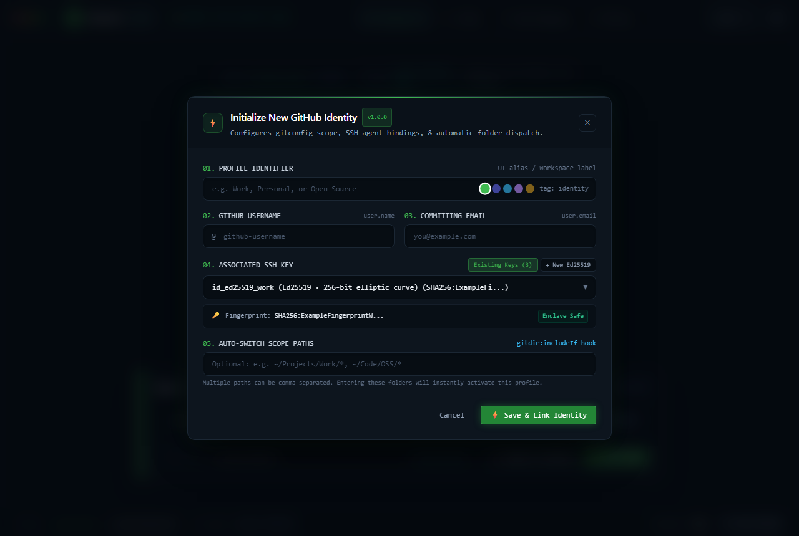
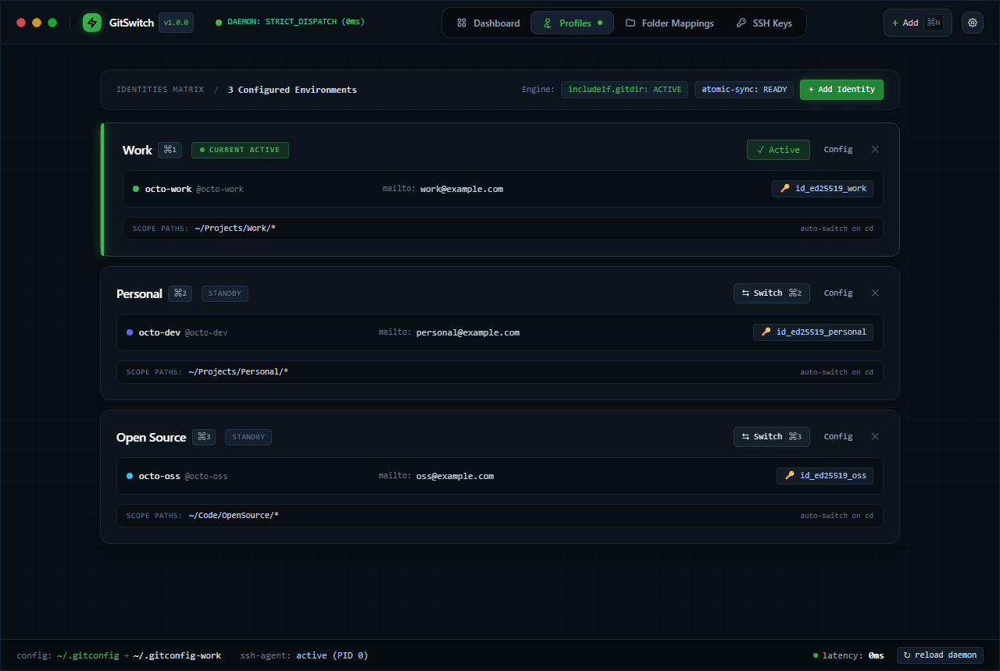
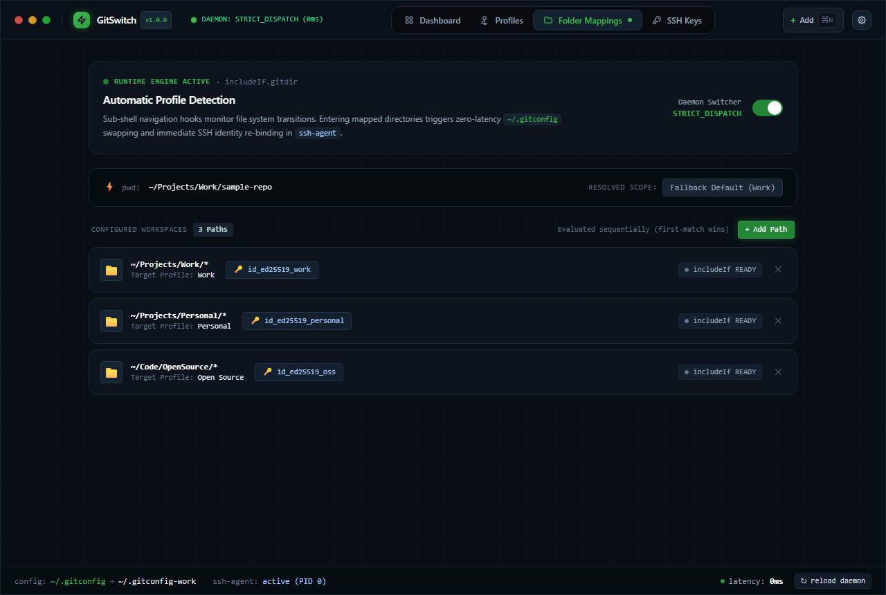
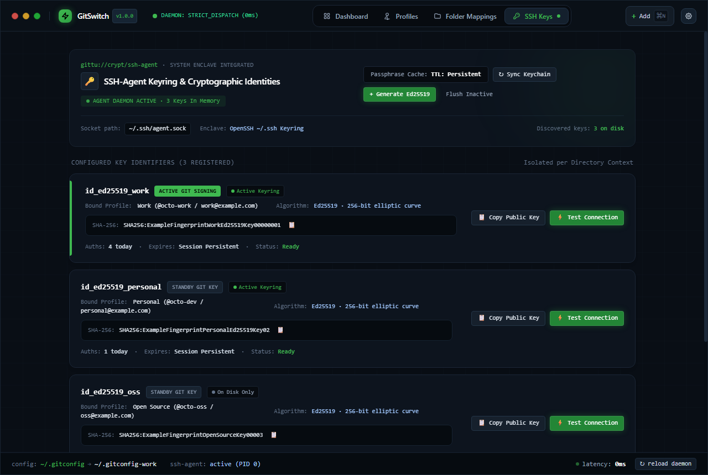

# GitSwitch (v1.0.0)

> **Offline-first desktop utility and MCP server for managing multiple GitHub accounts, SSH identities, and automatic directory-based Git configuration switching (`includeIf.gitdir`).**



---

## Downloads (GitHub Releases)

Download the prebuilt release for your platform from the **Releases** page:

- **Windows**: `GitSwitch_1.0.0_x64-setup.exe` / `.msi` installer, or portable `GitSwitch-v1.0.0-windows-x64.zip` (`gitswitch.exe` + `gitswitch-mcp.exe`)
- **macOS**: `GitSwitch_1.0.0_aarch64.dmg`
- **Linux**: `GitSwitch_1.0.0_amd64.AppImage` / `.deb` package
- **MCP Server**: `gitswitch-mcp` (`gitswitch-mcp.exe` on Windows)

GitSwitch launches cleanly with **zero pre-seeded or demo credentials** and automatically discovers existing public keys in `~/.ssh/*.pub`.

---

## How to Use GitSwitch

### 1. First Launch & Adding Your First Identity (`⌘N` / `Ctrl+N`)
1. Open GitSwitch and click **+ Add** in the top bar (or press `⌘N` / `Ctrl+N`).
2. Enter your **Profile Identifier** (e.g., `Work`, `Personal`, or `Open Source`), **GitHub Username** (`user.name`), and **Committing Email** (`user.email`).
3. Choose an existing key discovered from `~/.ssh/*.pub` **or** switch to **+ New Ed25519** to generate a real OpenSSH keypair (`ssh-keygen -t ed25519`) directly inside `~/.ssh/`.
4. Optionally add comma-separated **Auto-Switch Scope Paths** (e.g., `~/Projects/Work/*`) and click **Save & Link Identity**.



---

### 2. Switching Active Identities (`⌘1`–`⌘9` / `Ctrl+1`–`Ctrl+9`)
- **Rotary Dial (Dashboard)**: Click any profile node around the dial or drag the central rotary knob to switch your active global Git & SSH profile.
- **Profiles Matrix**: View all configured identities, copy or edit settings (`Config`), switch active status, or remove unused profiles.
- **Terminal Session Override**: Click **⚡ Apply to Terminal** on the Dashboard card to copy PowerShell and POSIX/Git Bash `GIT_AUTHOR_*` / `GIT_SSH_COMMAND` export commands for overriding a single shell session.

Every switch creates `.gitswitch.bak` backups (if not already present) and atomically updates:
- `~/.gitconfig` (`[user]`, `[core] sshCommand`, and `[includeIf "gitdir:..."]` blocks while preserving your aliases & custom settings)
- `~/.gitconfig-<profile-id>` (per-profile Git identity file)
- `~/.ssh/config` (`Host github.com` and `Host github.com-<profile-id>` aliases while preserving other SSH hosts)



---

### 3. Automatic Folder Switching (`includeIf.gitdir`)
Use the **Folder Mappings** tab to bind root workspace folders to specific GitHub profiles so Git automatically selects the right `user.name`, `user.email`, and SSH key whenever you work inside that directory—even without switching globally:
1. Click **+ Add Path** and bind a pattern such as `~/Projects/Work/*` or `C:/Work/Clients/*` to a target profile.
2. Enter any repository path in the **`pwd:` Path Resolver** bar to verify in real time which `includeIf.gitdir` rule matches.



---

### 4. SSH Keyring & Live Connection Testing
Use the **SSH Keys** tab to inspect and test real cryptographic keys stored in `~/.ssh/`:
- Click **↻ Sync Keychain** to re-scan `~/.ssh/*.pub` and check `ssh-add -l`.
- Click **+ Generate Ed25519** to create a new Ed25519 keypair in `~/.ssh/`.
- Click **📋 Copy Public Key** (then add the `.pub` key under **GitHub → Settings → SSH and GPG keys**).
- Click **⚡ Test Connection** to run a live `ssh -Tv -i ~/.ssh/<key> git@github.com` handshake and inspect the diagnostic output.



---

### 5. Inspect Generated Host Configs (`⌘,` / `Ctrl+,`)
Press `⌘,` (`Ctrl+,`) or click the settings icon in the top-right corner to inspect and copy your live `~/.gitconfig` and `~/.ssh/config` files at any time.

---

### 6. Model Context Protocol (MCP) Server (`gitswitch-mcp`)
GitSwitch ships a Stdio JSON-RPC `2.0` MCP server binary (`gitswitch-mcp`) exposing **14 tools** and **3 resources** so AI coding assistants can inspect status, switch identities, manage `includeIf` folder mappings, generate SSH keys, and test probes.

Register the downloaded or compiled binary path in [mcp_config.json](mcp_config.json) (or your MCP client's config):

```json
{
  "mcpServers": {
    "gitswitch": {
      "command": "/path/to/gitswitch-mcp",
      "args": []
    }
  }
}
```

- **Tools**: `get_status`, `list_profiles`, `switch_profile`, `save_profile`, `delete_profile`, `list_folder_mappings`, `save_folder_mapping`, `delete_folder_mapping`, `validate_hook`, `list_ssh_keys`, `generate_ssh_key`, `test_ssh_connection`, `get_config_files`, `apply_to_terminal`
- **Resources**: `gitswitch://config/gitconfig`, `gitswitch://config/sshconfig`, `gitswitch://state/profiles`

---

## Architecture

```
GitSwitch/
├── .github/workflows/
│   ├── ci.yml                 # Automated Rust tests & frontend build
│   └── release.yml            # Multi-platform GitHub Release builder
├── docs/screenshots/          # Application screenshots for documentation
├── scripts/
│   ├── package-release.ps1    # Windows release packager (release/v<ver>/)
│   └── package-release.sh     # macOS Universal & Linux release packager
├── src-tauri/
│   ├── Cargo.toml             # Tauri v2 + gitswitch & gitswitch-mcp binaries
│   ├── tauri.conf.json
│   └── src/
│       ├── main.rs            # Desktop GUI entrypoint
│       ├── lib.rs             # Core AppEngine & Tauri IPC commands
│       └── bin/
│           └── gitswitch-mcp.rs # Stdio MCP server (JSON-RPC 2.0)
├── frontend/                  # Svelte 5 + Vite + Tailwind CSS + Bits UI
├── mcp_config.json            # Portable MCP server configuration template
└── run-desktop.bat            # Windows launcher script
```

---

## Build from Source

### Prerequisites
- **Node.js** 20+ and **npm**
- **Rust** toolchain (`rustup`, `cargo`)
- **Tauri v2** platform prerequisites (WebView2 on Windows, `webkit2gtk` on Linux, Xcode CLT on macOS)

### Commands

```bash
# 1. Install frontend dependencies & build UI
cd frontend
npm ci
npm run build
cd ..

# 2. Run Rust & MCP unit tests
cargo test --manifest-path src-tauri/Cargo.toml

# 3. Build desktop application & installer bundles
./frontend/node_modules/.bin/tauri build

# 4. Build standalone MCP server binary
cargo build --release --bin gitswitch-mcp --manifest-path src-tauri/Cargo.toml
```

### Publishing Releases (Windows, macOS & Linux)

Package a versioned local release directory (`release/v1.0.0/` + SHA-256 checksums) on each target OS:

```powershell
# Windows (x64): builds gitswitch.exe, gitswitch-mcp.exe, portable .zip, SHA256SUMS.txt
.\scripts\package-release.ps1
```

```bash
# macOS (Universal arm64 + x64) or Linux (x64 / arm64): builds installers, portable .tar.gz, gitswitch-mcp
chmod +x scripts/package-release.sh
./scripts/package-release.sh
```

For automated cross-platform GitHub Releases across **Windows (`.msi`, `-setup.exe`, `.zip`)**, **macOS Universal (`.dmg`, `.tar.gz`)**, and **Linux (`.AppImage`, `.deb`, `.rpm`, `.tar.gz`)**, push a version tag (`v1.0.0`) or trigger the **Release GitSwitch** workflow in GitHub Actions:

```bash
git tag v1.0.0
git push origin v1.0.0
```

GitHub Actions (`.github/workflows/release.yml`) builds all three OS targets natively and attaches every installer, portable archive, and standalone `gitswitch-mcp` binary to the GitHub Release.

---

## Security & Privacy

- Offline-first: zero external network requests or telemetry (aside from explicit `ssh -Tv git@github.com` tests you trigger).
- No pre-seeded demo credentials or simulated SSH authentication responses.
- Private SSH keys remain locally inside `~/.ssh/`.
- `~/.gitconfig` and `~/.ssh/config` updates create automatic `*.gitswitch.bak` backups before writing atomically.
